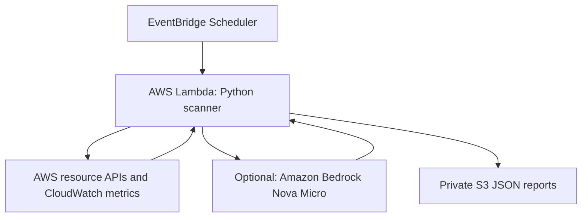

# AWS FinOps & Security Advisor

A serverless AWS account scanner that identifies selected cost optimization
opportunities and security configuration risks, then stores JSON reports
in a private S3 bucket.

Built with Python, boto3, AWS Lambda, EventBridge Scheduler, Amazon S3,
IAM, and an optional Amazon Bedrock integration.

## Project Status

| Component | Status |
| --- | --- |
| AWS resource scanning | Tested successfully |
| Private S3 report storage | Tested successfully |
| Daily schedule | Configured for 09:00 Australia/Sydney |
| Scheduler-to-Lambda execution | Verified using a one-time test |
| Security finding remediation | Public ingress restricted; finding count reduced |
| Bedrock summary integration | Implemented; successful inference verification pending |
| Failure alerting | Planned |

Amazon Nova Micro inference returned `ThrottlingException`.
Investigation showed that the account's applied on-demand request,
token-per-minute, and daily-token quotas were zero.
AI summaries are optional; rule-based reports remain available when
AI inference fails.

## Architecture



The scanner runs read-only checks against AWS resources.
It writes reports to S3 and execution logs to CloudWatch.
It does not automatically stop, resize, delete, or modify scanned resources.

## Checks Implemented

| Area | Check |
| --- | --- |
| EC2 | Low average CPU utilization over the previous seven days |
| EBS | Unattached volumes |
| Elastic IP | Addresses without an association |
| Security groups | Selected sensitive ports allowed from `0.0.0.0/0` |
| S3 | Bucket public-policy status |
| RDS | Public accessibility and storage encryption |
| IAM | Root account MFA status |

Findings include severity, evidence, resource information, and a
recommended action for human review.

## Scope and Limitations

- Scans the AWS account used by the Lambda execution role.
- Regional resource checks target `ap-southeast-2` (Sydney).
- S3 bucket-policy and root MFA checks cover account-level resources.
- No cross-account scanning is configured.
- Security-group checks cover selected IPv4 public-ingress rules.
- S3 policy status alone does not evaluate every possible access path.
- Low CPU utilization is a review signal, not proof that an instance
  can safely be downsized.
- Savings amounts are not calculated.
- Zero findings do not establish complete security or compliance.

## Security Controls

- Separate Lambda and Scheduler execution roles.
- Permissions scoped to required actions and resources where supported.
- S3 Block Public Access enabled.
- Reports encrypted using SSE-S3.
- A lifecycle rule expires reports under `reports/` after 30 days.
- AWS credentials are supplied through IAM roles.
- Resource identifier fields are excluded from the optional AI payload.
- Real reports and credentials must not be committed to this repository.

## Optional AI Summaries

The Bedrock integration uses the Converse API with Amazon Nova Micro
(`amazon.nova-micro-v1:0`).

When enabled and findings exist, it summarizes findings and prioritizes
recommended actions. Recommendations require human review.

If inference fails, the report preserves the findings and records a warning.
When no findings exist, the code returns a fixed explanatory message
without invoking the model.

## Configuration

| Environment variable | Purpose |
| --- | --- |
| `REPORT_BUCKET` | Destination bucket for reports |
| `SCAN_REGION` | Region used for regional resource checks |
| `ENABLE_AI_SUMMARY` | Set explicitly to `false` for scanner-only operation |
| `BEDROCK_MODEL_ID` | Model identifier for optional AI summaries |

## Local Validation

Requires Python 3.12 and the `zip` utility for packaging.

```bash
python3 -m unittest discover -s tests -v
bash scripts/package.sh
unzip -l build/lambda.zip
```

Unit tests cover expected rule findings, sensitive-port detection,
and exclusion of resource identifier fields from the AI payload.
They do not validate live AWS permissions or Bedrock account quotas.

## Deployment

Infrastructure was configured using the AWS Console and AWS CLI.

See [the Hinglish deployment guide](docs/DEPLOY_HINGLISH.md).

## Troubleshooting Demonstrated

- Diagnosed missing IAM permissions for deployment operations.
- Corrected the Lambda role's S3 report-write permission.
- Verified Scheduler invocation through a one-time execution.
- Restricted a flagged security-group rule to an approved office IP.
- Re-ran the scanner and observed findings decrease from two to one.
- Identified zero applied Bedrock quotas behind repeated throttling.

## Cost Considerations

Usage may incur charges for Lambda, S3, CloudWatch, EventBridge Scheduler,
and optional Bedrock inference.

Free Tier eligibility and credits depend on the AWS account.
Bedrock costs depend on the model, region, and token usage.
This project does not require an EC2 instance, EKS cluster, or NAT Gateway
to host the scanner.

## Author

Ankit Chaurasiya — DevOps / Cloud / Platform Engineer

## Example Output

See the [synthetic sample report](examples/sample-report.json) and its
[explanation](examples/README.md).
